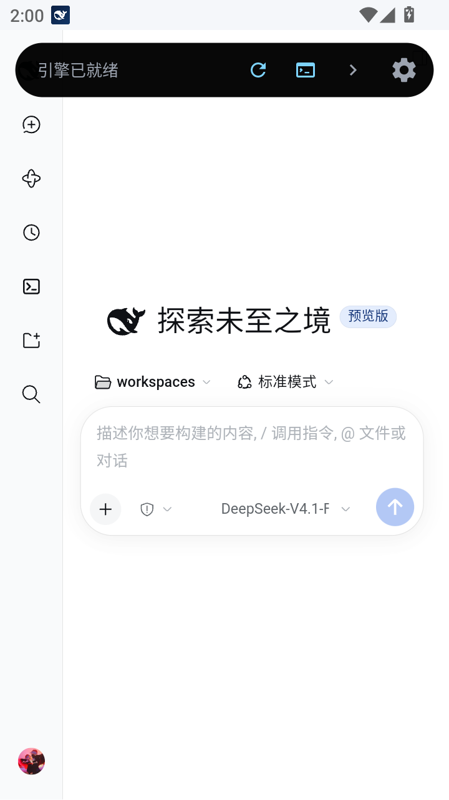
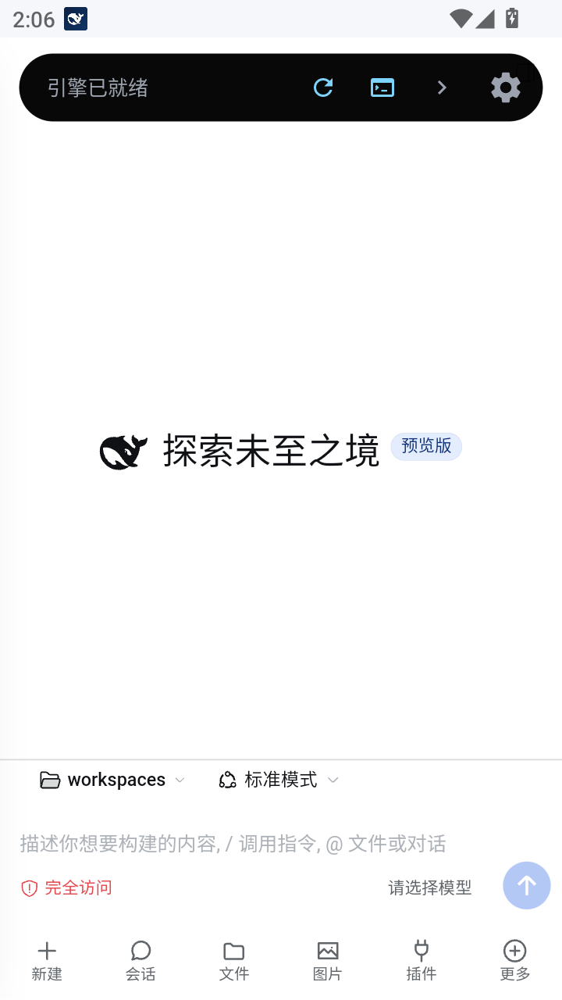
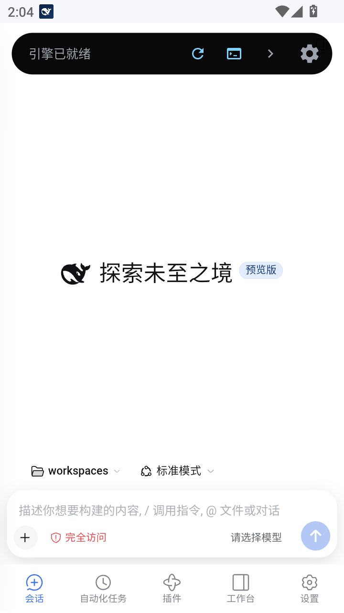
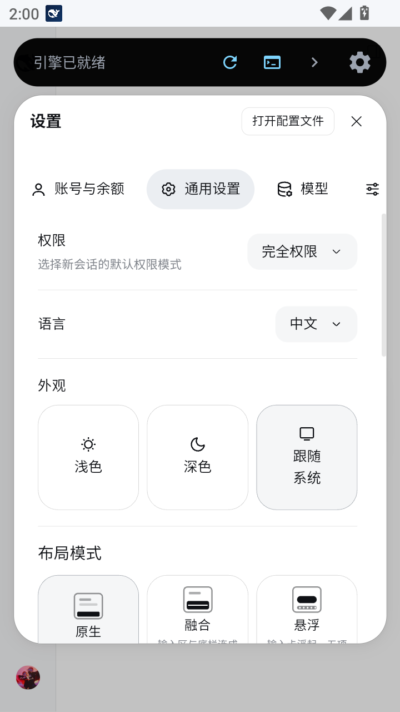
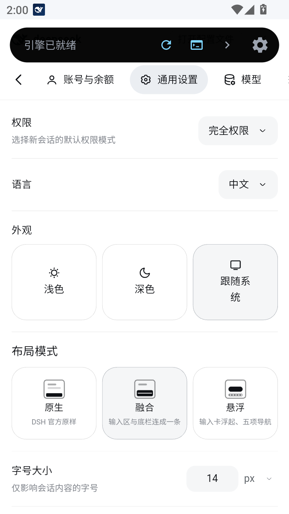
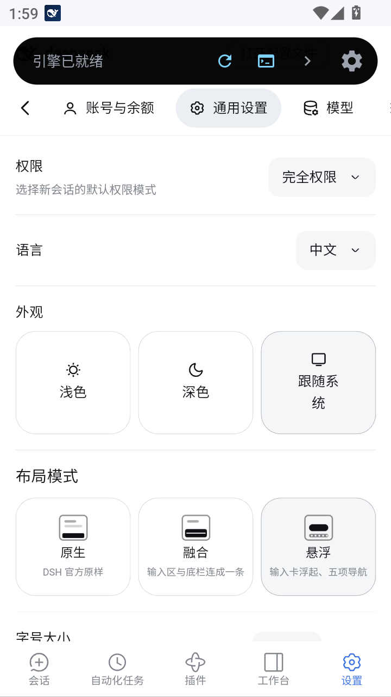

# dsh-mobile-layout

> English docs ｜ [中文版](README.md)

[](https://github.com/XiaoPb/dsh-mobile-layout/actions/workflows/ci.yml)
[](https://github.com/XiaoPb/dsh-mobile-layout/actions/workflows/release.yml)
[](https://www.npmjs.com/package/@xiaopb/dsh-mobile-layout)

**DSH mobile portrait layout plugin (v0.4.0)**

Docs: [Architecture](docs/architecture.md) ｜ [Technical notes](docs/technical-notes.md) ｜ [Presets](docs/preset-v2.md) ｜ [Changelog](CHANGELOG.md) ｜ [中文版](README.md)

A Cordis plugin that turns the DSH web client into a one-handed, touch-first layout on **phone portrait** screens — **without modifying the official kernel or replacing the official layout plugin**. It only adapts the phone-portrait form; landscape, tablet and desktop keep the official layout pixel-for-pixel.

---

## Features

- **Sidebar → Drawer**: swipe right from anywhere in the left ~60% of the screen (QQ-style, mid-left start — full-screen gesture phones reserve the hard edge for system back); **finger-following drag with velocity/position snap on release**; tap-mask or left-swipe to close. Gesture is the only entry — no button (so it never covers a sub-page's own back button); the listener lives on `window` in the capture phase and works on every plugin page. Auto-collapses only on real navigation (blank taps, search, account menu, etc. stay open).
- **Bottom action bar**: new / chat / file / image / plugins / more, pinned right above the composer.
- **Add panel**: **reveal / cover transition** against the soft keyboard (content-adaptive height; the keyboard slides over to cover the panel and slides away to reveal it, with the input row position preserved via viewport-jump compensation — no animation crossing); open/close slide animations (skipped automatically for reduce-motion users); a 4×2 icon grid with horizontal paging beyond 8 items; icons are **color-coded by function** (12 soft tints across blue / orange / violet / green — same type keeps the same color, no clashes on screen, new items auto-assigned by alias hash).
- **Sessions / plugins sheets**: grouped by workspace with sticky headers and relative timestamps, capped at 64% of screen height; **drag the grabber down to dismiss**, styled after the engine's v1.4.57 official sheet (28px corners, raised surface, large title, pill primary action).
- **Composer merged into the bottom panel**: flat, full-width, single 1px divider; tightened empty state; permission & model short-name chips stay on the input row (**"Full access" is always red**, in both Chinese and English).
- **Fullscreen settings**: brand row + swipeable tabs + back button; swipe left/right on the content area to switch tabs; the panel follows the finger and slides out only from the leftmost tab's right-swipe (all other directions yield to tab paging).
- **Restyled pickers**: model / permission sub-menus become bottom-sheet lists with the theme-blue selected state; no soft keyboard pops up when a picker opens in the empty state (search-box autofocus guard — tapping the search box still focuses normally).
- **Exclusive overlays + history stack**: drawer / bottom sheet / add panel never stack; closed layer-by-layer. The add panel is also mutually exclusive with the soft keyboard in both directions (opening it first drops composer focus; tapping the input while the panel is open closes the panel first, and the keyboard rises only after the panel is gone).
- **Three layout presets**: **Native** (stock DSH) / **Merged** (composer joined with the bottom bar) / **Floating** (mobile-app form), one tap in Settings, see below.
- **Live i18n**: every self-drawn label (layout-mode cards, bottom nav, panels) refreshes **instantly** when the official language changes — no restart needed; falls back to `<html lang>` / system language.
- **Accessibility & motion**: `aria-modal`, focus in/out, honors system "reduce motion".

### Three layout presets (Native / Merged / Floating)

The three layouts are **Native / Merged / Floating**: Native is DSH untouched; Merged joins the composer and the bottom bar into one block (v1); Floating lifts the composer card and adds a five-item nav (v2). There is exactly one place to switch: **Settings → General → Layout mode, right under Appearance**, offering three cards with mini wireframe thumbnails. Switching is instant, round-trips cleanly, and **plugin-provided config pages** (e.g. pet config, plugin market) are handled as well.

- **Native**: hands the whole screen back to the official layout; the official settings dialog is pinned into a **centered floating window** — equal left/right gutters, ~10% viewport height of top/bottom padding (floored on small screens, capped on tall ones). Switching from another preset keeps the settings page open.
- **Merged**: composer and bottom bar joined into one block; the empty-state dashed input card gets symmetric side gutters (previously flush left with a 7px skew from the official scrollbar gutter).

Floating is the **mobile-app form factor**: a five-item bottom nav acts as the page switcher, the composer floats, and the add panel becomes a two-level menu.

- **Five-item nav**: Sessions / Automations / Plugins / Workbench / Settings, using DSH's own icon set; the current page is tinted with the official blue (`--dsw-alias-state-business-primary`). Sessions acts as "go home" — from other pages it returns to the session page; tapped again on the session page it opens the session sheet. Plugins / Automations / Settings are **pages**, not sheets, so the nav stays put (tapping the active one returns to the session).
- **Workbench**: toggles the official right panel (`sidebarRight.toggleExpanded`); at phone widths the official code makes it fullscreen and the panel leaves room for the nav; **swipe sideways to dismiss**, and from a plugin/automation page it closes that page first.
- **Add panel (self-drawn)**: level 1 = three attachment tiles (**image / camera / file**) plus one row per official group; tapping a group opens level 2, a list of that group's items with **title + official description**. Data and actions still come from the official nodes — it reads their options and dispatches their `mousedown`; no command semantics are duplicated.
- **Cover-style drawers**: add / model / permission / workspace pickers slide up over the page instead of pushing content up; the session sheet is a fixed 55% of the viewport, leaving blank space when there are few rows.
- **Transparent bottom bar**: no fill and no divider, so the composer's soft shadow can spill into the nav row instead of being cut off.
- **Engine status band**: the host's own "engine ready" band is a native view (not in the DOM, not styleable, does not resize the viewport). `--dshm-engine-bar` (default 56px) reserves its height for panel headers; set it to `0px` if you always collapse the band first.

## Why it's good

| | |
|---|---|
| **Zero intrusion** | All styles are scoped under `data-dshm-mode="mobile"`; uninstall or anchor failure restores the official layout. |
| **Single-file build** | `lib/client.js` is the shipped artifact — no build step, no runtime dependencies. |
| **Conservative by form** | Detects three hosts (Android shell / desktop Electron / browser); the desktop DeepSeek Harness app **never activates** the mobile layout at any window size, and other non-phone forms keep the official layout pixel-for-pixel. |
| **Touch-first** | 44px touch targets, swipe gestures, one-handed reach. |
| **Stable theming** | Hash-based tint assignment — new feature icons are colored automatically, no code change. |
| **Adaptive geometry** | Gutters / radii / heights are all CSS variables (`clamp()` + safe-area insets) — no hardcoded px, scales across devices. |
| **Hardcoded-value guard** | CI scans the injected styles for fixed px layout values; **any new violation fails the build**, legacy ones live in a baseline that shrinks over time. |
| **Verified on device** | MuMu emulator (720×1280) and a Redmi K70 real device; **129** CI unit tests all green. |

---

## How it works


## Screenshots

> Real device screenshots of v0.4.0 on the MuMu emulator (physical 720×1280, CSS viewport 400×684), light theme. Full page galleries per preset: [Native](docs/preset-default.md) ｜ [Merged](docs/preset-classic.md) ｜ [Floating](docs/preset-v2.md).

<table>
  <tr>
    <th align="center"><a href="docs/preset-default.md">Native (stock)</a></th>
    <th align="center"><a href="docs/preset-classic.md">Merged (v1)</a></th>
    <th align="center"><a href="docs/preset-v2.md">Floating (v2)</a></th>
  </tr>
  <tr>
    <td align="center"><br><sub>Home</sub></td>
    <td align="center"><br><sub>Home</sub></td>
    <td align="center"><br><sub>Home</sub></td>
  </tr>
  <tr>
    <td align="center"><br><sub>Settings floating window</sub></td>
    <td align="center"><br><sub>Settings · layout mode</sub></td>
    <td align="center"><br><sub>Settings · layout mode</sub></td>
  </tr>
</table>

---

## Install

```sh
dsh plugin --profile web add @xiaopb/dsh-mobile-layout
```

## Develop / Release

No runtime or dev dependencies; the client is a single-file artifact (no build), `lib/client.js` is what ships.

```sh
npm run check             # node --check → unit tests → package / bundle contract → hardcoded-value guard
npm test                  # unit tests only (129)
npm run hardcode:check    # guard only (fails on new violations)
npm run hardcode:baseline # shrink the baseline after fixing violations
npm run pack:dry          # preview the files that will be published
```

Pushing a `v*` tag triggers Release (npm Trusted Publishing with `NPM_TOKEN` fallback, then polls until the version is public). Device acceptance needs a device and is done manually per section 6 of `docs/technical-notes.md`.

## License

MIT
