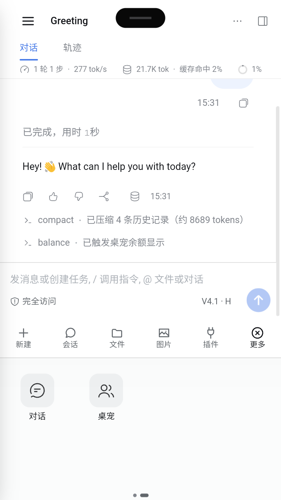
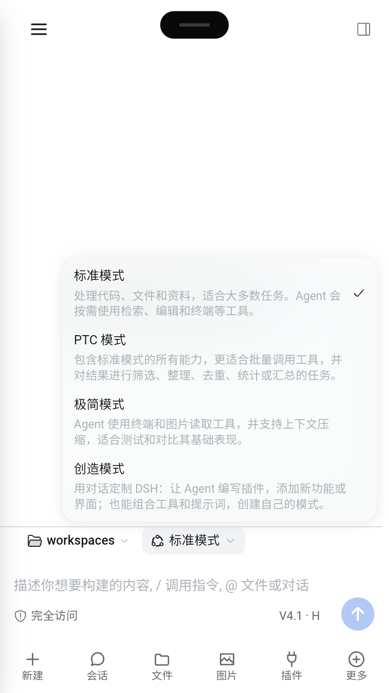
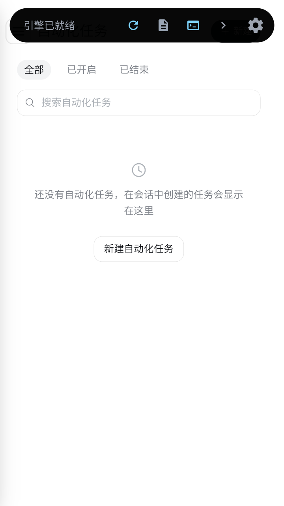
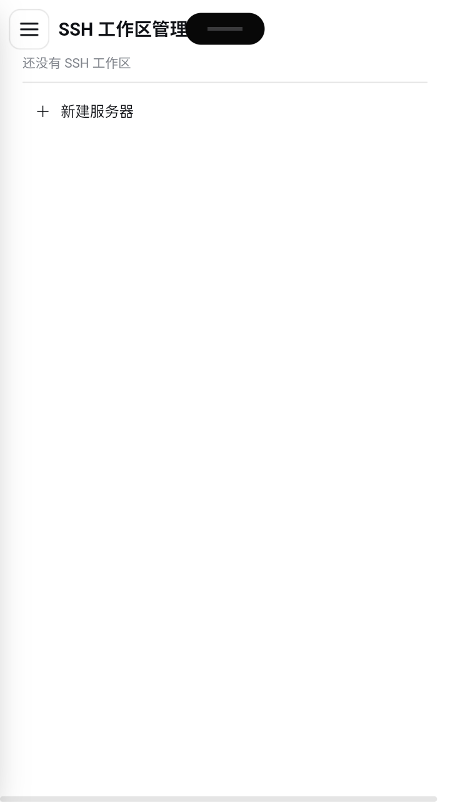

# dsh-mobile-layout

[](https://github.com/XiaoPb/dsh-mobile-layout/actions/workflows/ci.yml)
[](https://github.com/XiaoPb/dsh-mobile-layout/actions/workflows/release.yml)
[](https://www.npmjs.com/package/@xiaopb/dsh-mobile-layout)

**DSH 手机竖屏自适应布局插件（0.6.0）**

DSH 的 Web 客户端目前没有移动端布局：窄屏时左侧栏只是被压缩成 56px 轨道，右侧栏在 768px 以下才自动全屏，整份前端 CSS 没有任何宽度媒体查询。本插件在不修改官方内核、不替换官方布局插件的前提下，把**手机竖屏**切换成适合触控的形态：

- 左侧栏改为抽屉（汉堡入口 / 左缘滑动打开 / 遮罩或左滑关闭），点击抽屉内的会话、工作区或全局面板入口后自动收起（展开/折叠箭头与表单控件除外），不再占用内容宽度；抽屉宽度取 `min(86vw, 280px)`，即官方侧栏展开态的自然宽度，右缘正好收在右上「收起侧边栏」按钮的内边距处，不再留空白条；
- 全局面板（插件、设置、自动化任务、SSH 工作区等）没有会话头时，左上角浮动 ☰ 统一嵌在页面标题栏左侧：页头与标题都用几何探测（顶端 ≤24px、宽度 ≥50%、高度 14–160px；标题取最上层纯文本叶子），键垂直对齐标题行、标题及其同左缘的副标题右移让位，新增面板页无需再改代码；
- 输入框下方新增 56px 常驻条：新建 / 会话 / 文件 / 图片 / 插件 / 更多；加号面板贴屏幕最底部，以 4 列宫格（48px 圆角图标 + 标签）展开，常驻条与输入行随之上移，再点 ⊕ 旋转成 × 收起；面板与常驻条同一表面（全宽、同底色、无圆角阴影），仅用一条分隔线区分；
- 底部「会话」面板按工作区分组（官方抽屉式）：多个工作区时每组一条分组标题（11px 灰字 + 组内会话数，滚动时吸顶），会话行缩进一级，不再逐行重复工作区名；只有一个工作区时不出现分组标题，改在「会话」标题旁标一次；每行右侧显示相对时间（刚刚 / N 分钟 / N 小时 / 昨天 / N 天 / M-D，跨年补年份）；名称按会话 `cwd` 匹配官方 `workspaces.list` 的 `path`（统一分隔符 / 去尾斜杠）取 `title`，查不到（工作区已删或改名）退回 `cwd` 目录名，`cwd` 也没有的行归入「未归入工作区」组；面板高度随内容自适应，最多占屏高 60%（留住上方对话上下文、便于单手操作），仅在屏特别矮时用 280px 下限继续长高，并始终封顶在宿主顶部悬浮条以下；
- 加号面板最多两行：项数超过 8 个时横向分页（QQ 式），一屏一页、拖动或滑动切换；页位置用面板最底部的一排小圆点指示（当前页拉成短条），圆点浮在面板内边距里、不额外增加面板高度；与常驻条重复的「文件」不再在面板里重复出现；
- 输入行紧贴常驻条上沿（空会话态同样贴底，不再悬浮在页面中间）；输入行内的官方 ⊕ 隐藏，只保留常驻条最右侧的 ⊕；
- 输入区与常驻条融合为同一条全宽底部面板：去掉官方输入卡的圆角、边框、阴影与左右留白，宽度与常驻条一致，面板之间只用一条 1px 分隔线（输入区顶端）区分；输入区顶端与上方会话正文之间的分界线加深为 1px `rgba(0,0,0,0.14)`（官方 0.5px 浅灰在窄屏缩放下几乎不可见），「对话输入区」与「信息页面」边界明确；空会话（hero）态分界线不再停在输入座顶端，改画在输入卡上方紧邻的「工作区选择 / 标准模式」行顶边，不会横穿 hero 内容；hero 消失（发送消息或进入正常会话）即回到输入座顶端；
- 空态输入卡片收紧：输入框一行高度由官方 36px 压到 24px（2/3）并去掉顶部内边距，工具行上方留白压到 4px；多行输入仍按官方逻辑自增长，空态不再有大段空白；
- 空会话的图标与「探索未至之境」不再跟随聊天框贴底：官方空态浮层内的内容块按「标题栏/状态带下沿 → 输入卡上沿」的中点垂直居中，落在信息页面中央，输入卡仍贴底；
- 空会话输入卡上方的「工作区选择 / 标准模式」选择器，官方菜单固定在按钮下沿展开，会压住输入卡；移动态改为贴着选择行按钮上方弹出，上方空间不足时菜单内部滚动，权限 / 模型菜单不受影响；
- 权限模式留在输入行左侧，显示「图标 + 短文案」（完全访问 / 工作区 / 只读）；模型与思考等级留在右侧并显示短名（`V4.1 · H`），点击保持官方原始弹层，不再底部化；
- 会话统计（轮次/速度、Token 用量、上下文占用）从输入区挪到会话标题栏下方的常驻细条，正文从细条下方开始；详情弹层固定在该细条下方展开；右栏全屏时细条隐藏；
- 右上保留官方右栏开关；紧凑顶栏与 44px 触控目标，右栏全屏时补安全区、顶部工具放大到 44px，返回键优先关闭右栏；
- 右上角 `⋯` 打开官方菜单时保持右上角下拉列表：紧贴按钮下沿、右缘紧贴窗口（Android WebView 缩放导致 `right: 0` 内缩时按实测空档自校正），不再并入底部面板；菜单展开时统计状态带保持可见（header 与菜单祖先链已抬升为层叠上下文，菜单直接盖住状态带右侧，不再隐藏状态带，避免标题栏下方出现空白）；菜单面不透明，且展开时把菜单到顶栏的祖先链抬成层叠上下文，越过官方 `_tabs`（对话/轨迹 切换条，透明但全宽），菜单内「下载 Session 日志」等首行可正常点击；
- 浮层互斥：抽屉、底部表、加号菜单不会叠加；遮罩 / 左滑 / Android 返回键都能关闭当前浮层；返回键按「设置页 → 加号面板 / 顶部 ⋯ 菜单 → 底部表 → 抽屉 → 右栏」的层序逐层关闭，官方那几层弹层自身不响应返回键，由插件接管（否则会越过 WebView 直接退出应用）；
- 设置页在手机上改为全屏：顶部先是一条 `deepseek` 品牌行（鲸鱼图标取自官方抽屉，页签因此下移、不再被宿主顶部的「引擎已就绪」悬浮条/把手压住），接着是可横滑的页签 chip（44px 高、激活项自动居中），再是右对齐的「打开配置文件 / 关闭」工具行，内容区整块滚动；外观主题卡片在窄于 430px 时排两列（三列会把「跟随系统」挤成两行），开关、下拉与卡片热区都按触控放大；
- 按视口宽度、高度比例与方向自动判定「手机竖屏」，其他形态（横屏、平板、桌面）**保持官方默认布局**，像素级不变；
- 全量样式受 `data-dshm-mode="mobile"` 作用域保护，锚点失败或插件卸载即回退默认布局。

## 状态

0.6.0：加号面板从「一页铺满」改为「两行宫格 + 横向分页」，真机实测 11 项（过滤掉与常驻条重复的「文件」后 10 项）排成 2 行 × 4 列 × 2 页，面板高度恒定 203px（物理 `0,509,401,203`），一次滑动一页（`scrollLeft` 0→393，`scrollWidth` 785 = 2×`clientWidth`），页位置由面板最底部的圆点指示（`bottom = 安全区 + 3px`、高 8px，不占额外高度）；分页用显式 `grid-column/grid-row` 定位而不是 `order` 重排（网格按排名压缩 order 空号，实测 11 项时第二页的「余额/对话」会漏进第一页）；设置页改为全屏（`0,0,401,712`）：顶部品牌行 + 可横滑页签（6 个 chip 均高 40、激活项自动居中、`scrollWidth` 710 > `clientWidth` 401）+ 右对齐工具行（「打开配置文件」压到 32px、「关闭」44×44），内容区 `flex:1` 且自身滚动，六个页签逐个巡屏无裁切/竖排/横向溢出，外观卡片窄屏两列；返回键接管官方弹层：加号面板、顶部 ⋯ 菜单、设置页此前按返回都会直接退出应用（官方不处理返回键），现由插件逐层关闭，并加「关闭过渡闸门」避免关闭动画期间重复压栈把下一次返回吃掉（真机复现：设置页第一次返回只切了页签），连测 6 轮「开设置 → 返回」均为一次关闭且应用存活；会话面板补工作区信息并改为官方抽屉式分组：按会话 `cwd` 对上官方 `workspaces.list` 的 `path`，≥2 个工作区时每组一条吸顶标题（11px 灰字 + 组内条数）、会话行缩进 24px 且不再逐行重复工作区名，仅 1 个时标在「会话」标题旁（实测 `会话 workspaces`，行高保持 44px 单行）；每行右侧补相对时间（刚刚 / N 分钟 / N 小时 / 昨天 / N 天 / M-D，跨年补年份）；面板高度随内容自适应，上限取屏高 60%（探针实测 `max-height` 426.6px @711），屏特别矮时退到 280px 下限继续长高，并始终封顶在宿主顶部悬浮条以下（实测 sheet `top 419` / `h 236` / `list clientHeight = scrollHeight = 176`，内容恰好 4 行时不硬撑、也不产生空滚动）；形态回归：非手机形态（视口 500×556）插件完全退出、官方布局像素不变，小尺寸 640×1136（CSS 356×631）下分页与设置页同样正常。0.5.12：空会话「工作区选择 / 标准模式」选择器的官方菜单由向下改为向上弹出（实测按钮 CSS 20,541 122×28、官方菜单 20,573，会压住输入卡；现贴按钮上方、底部距行顶 5px，菜单内可滚动），模式菜单实测从 264 高度 272，点选「极简模式」后 chip 即时更新、再选「标准模式」恢复；0.5.11：空会话（hero）态把输入区顶端分界线从输入座顶端下移到输入卡上方紧邻的「工作区选择 / 标准模式」行顶边（实测物理 871→972，CSS ≈540.5），hero 消失即回到会话态输入座顶端（物理 1037），空态/非空态切换无残留；0.5.10：形态判定、抽屉、底部常驻条、会话/插件底部表、文件/图片回流、贴底宫格面板（与常驻条同表面、分隔线区分、⊕ 二次点击收起）、输入区与常驻条融合（去圆角/边框/阴影、全宽同表面）、输入区与上方会话正文之间的 1px 分界线（0.5px 浅灰改为 `rgba(0,0,0,0.14)`）、输入行贴底与输入行内 ⊕ 隐藏、权限/模型恢复官方原始弹层、输入区短名 chip、右栏返回键与安全区、会话统计状态带（标题栏下方常驻细条、详情弹层下移、右栏全屏隐藏、顶栏菜单展开时保持可见并由菜单盖住右侧部分）、右上角 `⋯` 下拉菜单（紧贴按钮、右缘自校正贴住窗口右缘、菜单面不透明、展开时抬升祖先层叠上下文越过官方 `_tabs` 使首行可点击）、空态输入框收紧到官方一行高度的 2/3 且多行仍自增长；0.5.8 增加抽屉内选项点击自动收起、全局面板左上角浮动 ☰ 嵌入页面标题行左侧（首个内容块右移让位、不再遮挡标题）、空会话 hero（图标 + 「探索未至之境」）居中到信息页面；0.5.9 把抽屉宽度由 320px 收到官方侧栏自然宽度 280px（`min(86vw, 280px)`），实测抽屉右缘由物理 568 收到 505（CSS ≈280），与右上「收起侧边栏」按钮之间只保留官方 12px 内边距；0.5.10 统一各全局面板的浮动 ☰：此前面板页只按 `header[data-window-drag]` 判断、标题行限高 24–88px，SSH 工作区的 20px 单行标题探测不到（☰ 压住标题），自动化任务则是按钮偏上、标题未让位；现改为以会话头 `.dshm-menu-btn` 可见性做门控，页头判定放宽到高度 14–160px、顶端 ≤24px，标题取页头内最上层纯文本叶子，同左缘的最外层文本块一起右移，实测插件 / 自动化任务 / SSH 工作区标题均落在 52px、与 ☰ 保持 8px 间距，右对齐工具位置不变。以上均在 MuMu 模拟器（360×640dp 竖屏）与 Playwright 360×640 验证（含「下载 Session 日志」实机点击后生成 ZIP）；软键盘弹起保持手机布局。实施计划与验收矩阵见 [docs/mobile-layout-plan.md](docs/mobile-layout-plan.md)。

## 界面截图

以下均为插件 0.6.0 在 MuMu 模拟器（物理 720×1280、dpr2、页面缩放 0.9，CSS 视口 400×711）上的整机实机截图，覆盖所有已适配的界面。截图前已通过宿主（DSH 手机端）「引擎已就绪」悬浮条右侧的 `>` 将其收起，顶部中央残留的小黑条是收起后的把手，因此页面顶栏的 ☰、标题与右上工具都完整可见。

| 空会话：hero 居中 + 分界线落在工作区选择行 | 会话：分界线回到输入座顶端 |
|---|---|
|  |  |
| 图标与「探索未至之境」在信息页面居中；1px 分界线（物理 y≈972）画在输入卡上方紧邻的「workspaces / 标准模式」行顶；输入卡贴底，下方为常驻操作条 | 发送消息后 workspace 行消失，分界线回到会话态输入座顶端（物理 y≈1037）；统计状态带在标题栏下方 |

| 抽屉（左缘右滑打开） | 加号面板第一页（两行宫格） |
|---|---|
|  |  |
| 侧栏改为 280px 抽屉，官方导航完整保留：新会话、插件、自动化任务、SSH 工作区等 | ⊕ 展开为 4 列 × 2 行：目标 / 计划 / 反馈 / 压缩、权限 / 模型 / 下载日志 / 余额；底部圆点表示还有第二页 |

| 加号面板第二页 | 设置页 · 账号与余额 |
|---|---|
|  |  |
| 左滑翻页，「对话 / 桌宠」落在第二页；圆点随页码变化，当前页拉成短条 | 全屏设置页：顶部 `deepseek` 品牌行把页签垫到悬浮条下方，页签可横滑，工具行右对齐 |

| 设置页 · 通用设置 |
|---|
|  |
| 权限 / 语言下拉、外观主题卡片（窄屏两列，卡片文字单行）、字号与工作步骤展示；开关与下拉热区已按触控放大 |

| 底部会话表 | 权限选项表 |
|---|---|
|  |  |
| 会话按工作区分组，当前会话带「当前」标记与相对时间 | 输入行左侧权限 chip 打开：仅可查看 / 工作区内修改 / 完全权限 |

| 工作区选择菜单向上弹出 | 模式选择菜单向上弹出 |
|---|---|
|  |  |
| 菜单贴着「workspaces」按钮上方展开，不再压住输入卡 | 标准 / PTC / 极简 / 创造 四个模式同样向上展开，选中后 chip 即时更新 |

| 全局面板：插件 | 全局面板：自动化任务 |
|---|---|
|  |  |
| 无会话头的面板页由左上角浮动 ☰ 兜底，与页头首行对齐，标题/副标题右移让位 | 已开启 / 已结束 切换、搜索与「新建自动化任务」均保留，左上角同样有浮动 ☰ |

| 全局面板：SSH 工作区 |
|---|
|  |
| SSH 工作区列表与「＋ 新建服务器」；☰ 不随页面标题高度变化而错位 |

## 安装

```sh
dsh plugin --profile web add @xiaopb/dsh-mobile-layout
```

## 开发与发布

本包无运行时 / 开发依赖，客户端是单文件产物（不需要构建），`lib/client.js` 即发布物。

```sh
npm run check     # node --check lib/client.js → 单测 → 包清单 / bundle 契约自检
npm test          # 仅单测（30 项：形态判定滞回、权限 / 模型短文案、加号面板分页、设置页判据、工作区分组与相对时间）
npm run pack:dry  # 查看将发布的文件（prepack 会跑 verify-package）
```

CI/CD 与 [dsh-mobile-compose](../dsh-mobile-compose) 保持一致：

- `.github/workflows/ci.yml`：push / PR / 手动触发，Node 22 与 24 矩阵；依次执行依赖安装、`npm run check`、`npm pack --dry-run`、实际打包、`scripts/release-notes.sh` 结构校验，最后在干净目录里像消费者一样安装 tarball 并断言 `dsh.*` 元数据、`lib/client.js` 的 `__ModuleLoader__` 包装以及开发目录未进包。
- `.github/workflows/release.yml`：推 `v*` tag 或手动触发。先校验 tag ↔ `package.json` 版本一致，再跑同一套自检；`scripts/publish-npm.sh` 优先走 npm Trusted Publishing（OIDC），不可用时回退 `NPM_TOKEN`，并在发布后轮询确认版本已在 registry 可见；随后打包、生成 SHA-256、用同一脚本生成完整发布说明（版本信息 / 安装 / 发布产物 / 分类变更 / 质量校验 / 贡献者 / 对比）并创建或更新 GitHub Release。
- 真机验收（MuMu 模拟器上的布局、抽屉、键盘、返回键等）需要设备，不在 CI 中执行，按 `docs/mobile-layout-plan.md` 的验证矩阵手动完成。

发布步骤：改 `package.json` 版本 → 提交 → `git tag v0.6.1` → push tag（或手动跑 Release workflow）。仓库需配置 Secret `NPM_TOKEN`，或在 npm 包设置里登记 Trusted Publishing（workflow 名 `release.yml`）。

## 命名

选 `dsh-mobile-layout`：与已有的 `dsh-mobile-compose`（手机端输入体验）形成同一命名族，职责边界清晰——`compose` 管输入，`layout` 管外壳。

## 许可证

MIT
