# dsh-mobile-layout

> 中文文档 ｜ [English version](README.en.md)

[](https://github.com/XiaoPb/dsh-mobile-layout/actions/workflows/ci.yml)
[](https://github.com/XiaoPb/dsh-mobile-layout/actions/workflows/release.yml)
[](https://www.npmjs.com/package/@xiaopb/dsh-mobile-layout)

**DSH 手机竖屏布局插件（v0.1.9）**

文档：[架构文档](docs/architecture.md) ｜ [技术说明](docs/technical-notes.md) ｜ [English](README.en.md)

一个 Cordis 插件，让 DSH Web 客户端在**手机竖屏**下变成单手可操作的触控布局——**不修改官方内核、不替换官方布局插件**。仅识别手机竖屏形态，横屏 / 平板 / 桌面保持官方原样，像素级不变。

---

## 核心功能

- **左侧栏 → 抽屉**：汉堡入口 / 屏幕左侧约 40% 区域（QQ 式，中间偏左起手）右滑打开，遮罩或左滑关闭；只在真正换页时自动收起（点空白、搜索、账号菜单等保持展开）。
- **顶部侧栏键**：插件 / 设置 / 自动化 / SSH 等全局面板，无会话头时 Sidebar 图标键贴在页面标题左侧（无边框底色，视觉上嵌入标题行；标题太靠左时才回退让位）。
- **底部常驻操作条**：新建 / 会话 / 文件 / 图片 / 插件 / 更多，紧贴输入区上沿。
- **加号面板**：4 列 × 2 行宫格，超过 8 项横向分页；图标**按功能类型配色**（蓝 / 橙 / 紫 / 绿 12 档柔和色，同类型同色、同屏不撞色、新增功能按别名哈希自动落位）。
- **会话面板**：按工作区分组、吸顶标题、相对时间，最多占屏高 60%。
- **输入区融合底部面板**：去圆角 / 边框 / 阴影、全宽同表面、1px 分界；空态收紧；权限与模型短名 chip 留在输入行（**「完全访问」恒标红**，中英文都认）。
- **设置页全屏**：品牌行 + 可横滑页签 + 返回键；内容区左右横滑切换页签。
- **选择器重造型**：模型 / 权限二级菜单改为贴底列表，选中态用主题蓝。
- **浮层互斥 + 历史栈**：抽屉 / 底部表 / 加号面板互斥，按层序逐层关闭；加号面板与输入法互斥（开面板先收键盘，杜绝面板与软键盘同屏）。
- **无障碍 & 动效降级**：`aria-modal`、焦点进出、尊重系统「减少动态效果」。

## 优势

| | |
|---|---|
| **零侵入** | 全部样式受 `data-dshm-mode="mobile"` 作用域保护，卸载或锚点失败即回退官方布局。 |
| **单文件产物** | `lib/client.js` 即发布物，无构建、无运行时依赖。 |
| **形态保守** | 识别三种宿主（Android 壳 / 桌面 Electron / 浏览器）；桌面端 DeepSeek Harness **永不激活**（任何窗口尺寸官方布局不变），其余形态只认手机竖屏、像素级不变。 |
| **触控优先** | 44px 触控目标、滑动手势、单手可达。 |
| **稳定配色** | 哈希落位，新增功能图标免改代码自动配色。 |
| **真机验收** | MuMu 模拟器（720×1280）与 Redmi K70 真机复核，CI 单测 55 项全绿。 |

---

## 工作原理

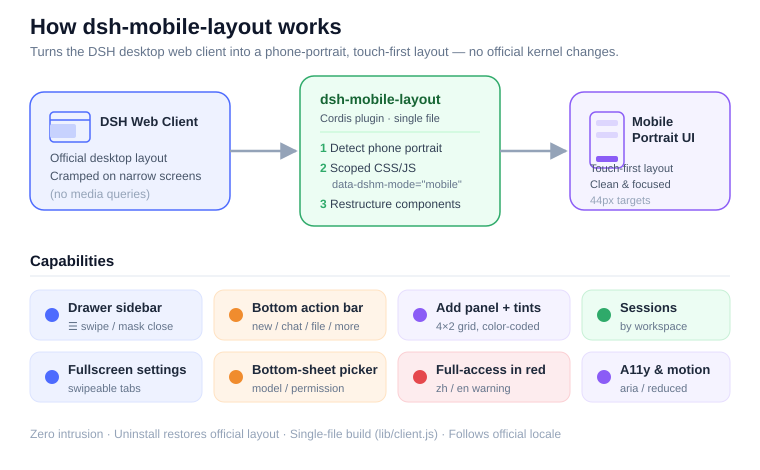

## 界面截图

> 均为 v0.1.6 在 MuMu 模拟器（物理 720×1280，CSS 视口 400×711）的整机实机截图。

| 空会话（hero 居中） | 会话（分界线回到输入座） |
|---|---|
| 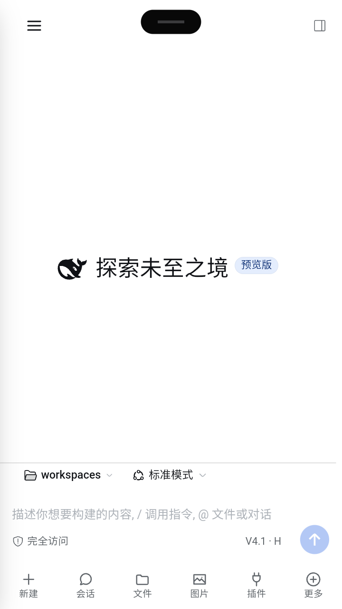 | 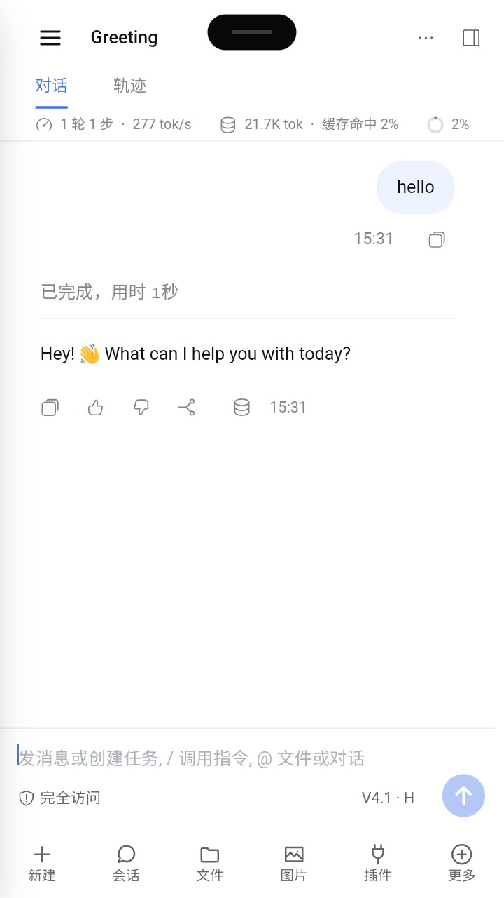 |

| 抽屉 | 加号面板（两页） |
|---|---|
| 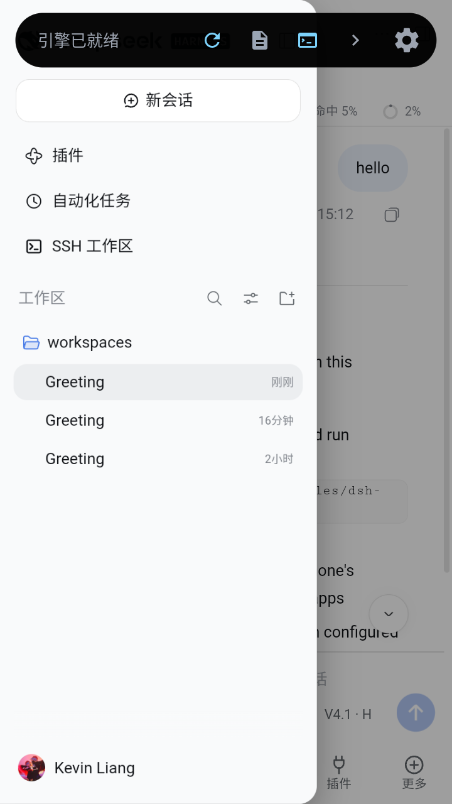 | 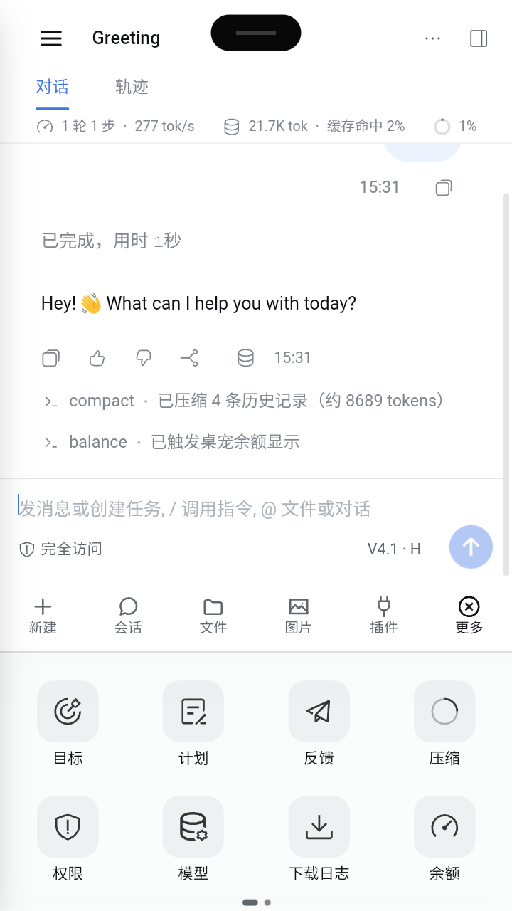 |

| 设置页 · 账号 | 设置页 · 通用 |
|---|---|
| 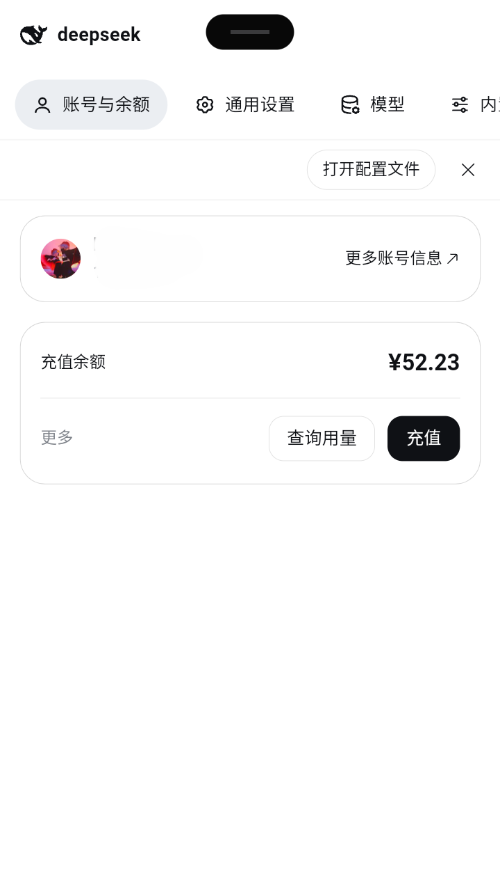 | 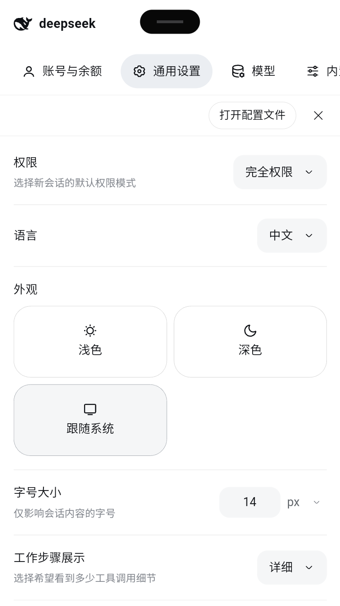 |

| 会话表（按工作区分组） | 权限选择（完全权限标红） |
|---|---|
| 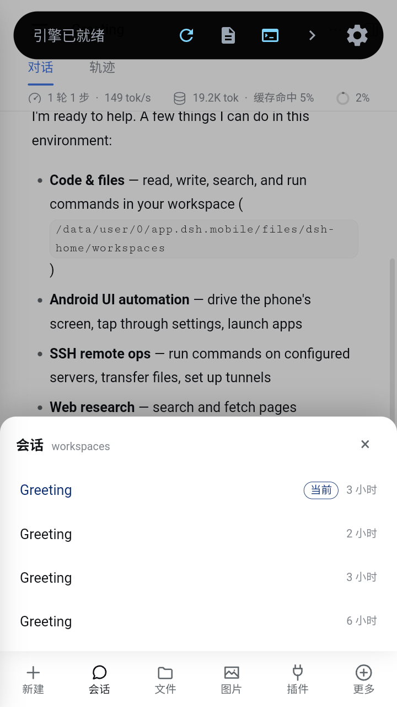 | 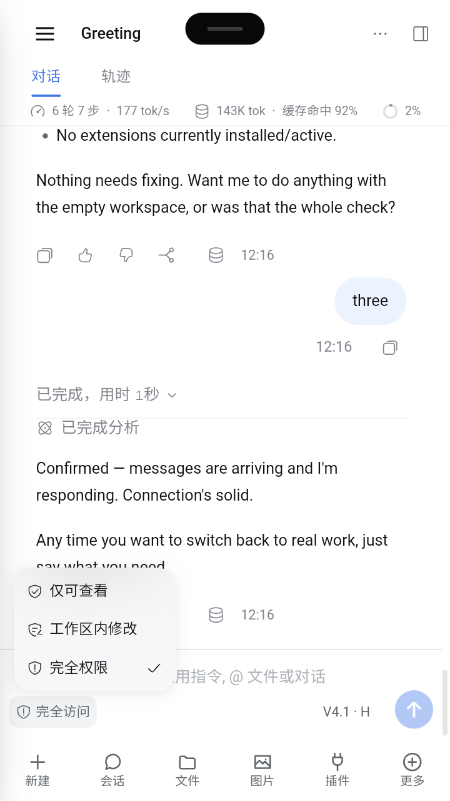 |

| 全局面板 · 插件 | 权限 / 模式菜单向上弹出 |
|---|---|
| 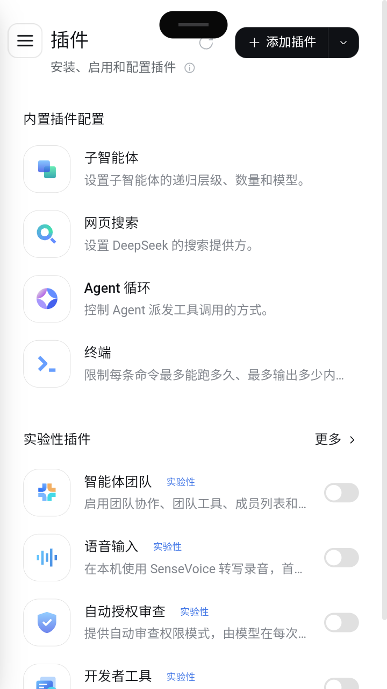 | 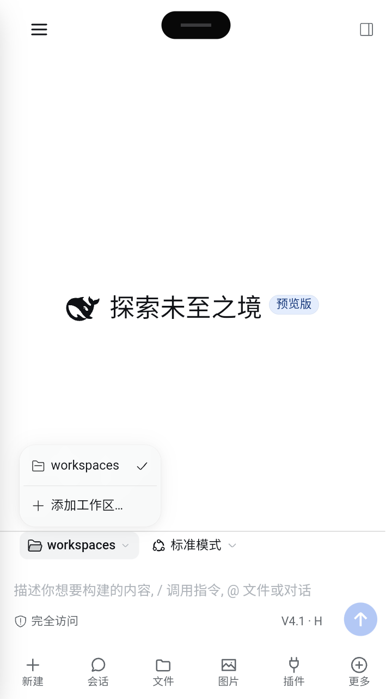 |

---

## 安装

```sh
dsh plugin --profile web add @xiaopb/dsh-mobile-layout
```

## 开发 / 发布

本包无运行时 / 开发依赖，客户端是单文件产物（无需构建），`lib/client.js` 即发布物。

```sh
npm run check     # node --check → 单测 → 包清单 / bundle 契约自检
npm test          # 仅单测（55 项）
npm run pack:dry  # 查看将发布的文件
```

推 `v*` tag 即触发 Release（npm Trusted Publishing / `NPM_TOKEN` 兜底，发布后轮询确认公开）。真机验收需设备，按 `docs/technical-notes.md` 第 6 节手动完成。

## 许可证

MIT
