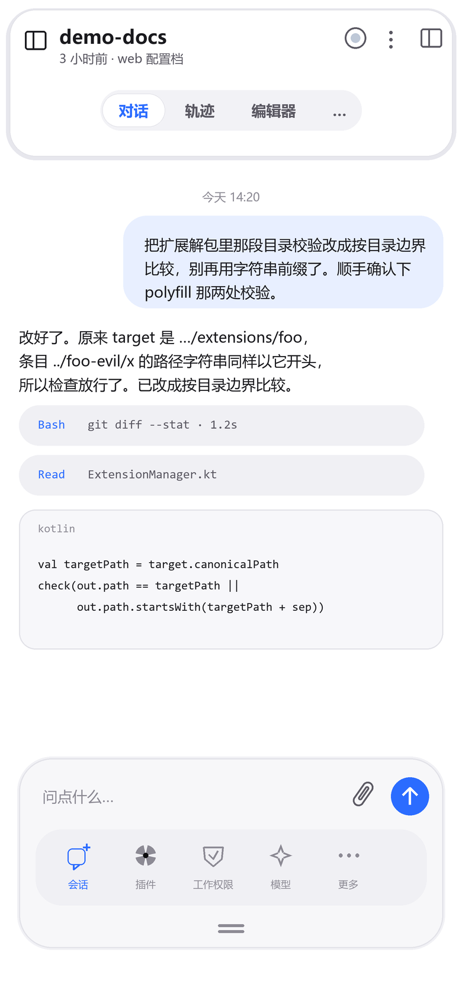
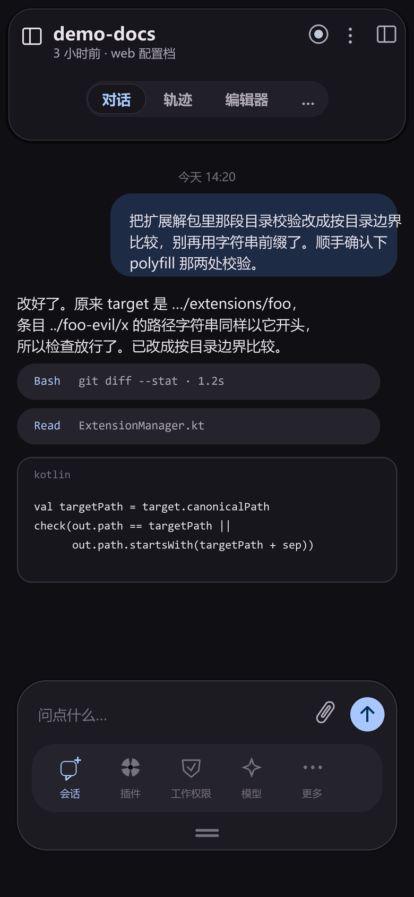
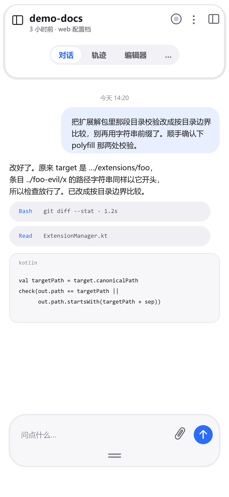
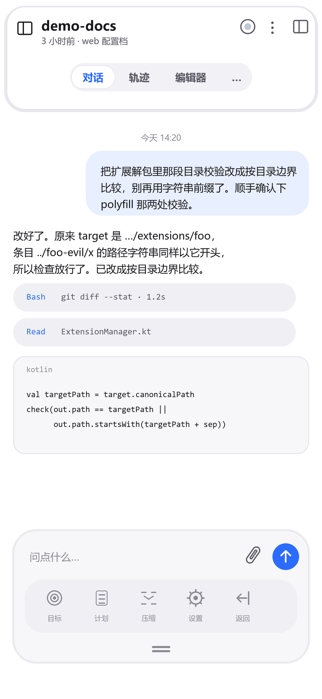
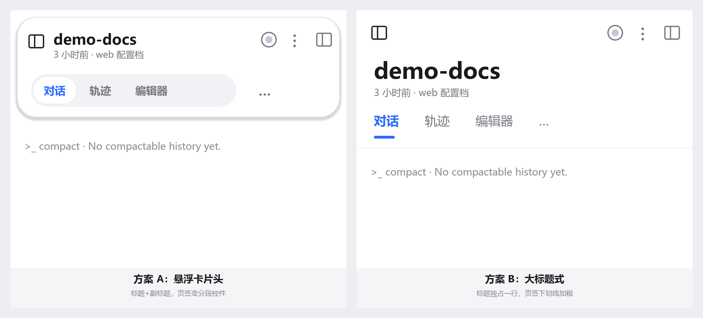
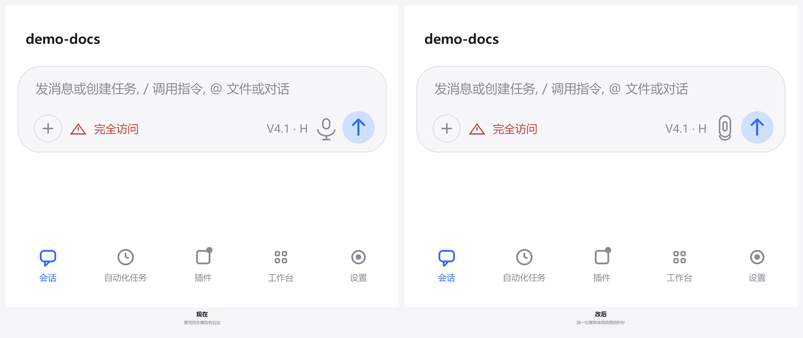

# 底部胶囊（dock）

> 悬浮预设（v2）的底栏外观增强：底栏浮起成胶囊，底部加一枚抽屉式把手。
> 当前只实现「胶囊 + 把手」；合并输入区、两页导航、顶部卡片头见文末「未实现」。

其他预设：[原生](preset-default.md) ｜ [融合](preset-classic.md) ｜ [悬浮](preset-v2.md) ｜ 回到 [README](../README.md)

---

## 界面总览

<table>
  <tr>
    <th align="center">浅色</th>
    <th align="center">深色</th>
  </tr>
  <tr>
    <td align="center"></td>
    <td align="center"></td>
  </tr>
  <tr>
    <td valign="top">底栏浮起为胶囊：圆角 <code>1.6em</code>、1px 描边、轻阴影、背景模糊。</td>
    <td valign="top">同一套布局，颜色走官方变量，深色下字号 +1（正文与导航标签）。</td>
  </tr>
</table>

<table>
  <tr>
    <th align="center">收起态</th>
    <th align="center">第二页（规划）</th>
  </tr>
  <tr>
    <td align="center"></td>
    <td align="center"></td>
  </tr>
  <tr>
    <td valign="top">点把手只收起导航，输入行保留；把手位置固定，不跟着跑。</td>
    <td valign="top"><b>仅为设计稿</b>：点「更多」后的第二页，动作尚未接官方 API。</td>
  </tr>
</table>

其他参考：（顶部卡片头方案）·
（输入区回形针附件）

---

## 几何与颜色

尺寸全部走 `em` / `calc()`，不新增硬编码 px（CI 的 `check-hardcoded.mjs` 会拦）：

| 项 | 值 | 说明 |
|---|---|---|
| 胶囊圆角 | `1.6em` | 随字号缩放，小屏自动收 |
| 左右留白 | `0.9em` | 与输入卡同宽 |
| 胶囊描边 | `1px` | `--dsw-alias-border-l1` |
| 阴影 | `0 0.55em 1.4em rgba(0,0,0,.14)` | 深色下自动够用 |
| 背景 | `--dsw-alias-bg-elevated` | 叠 `blur(12px)` |
| 把手横杠 | `2em × 0.18em`，间距 `0.45em` | `currentColor` + `opacity .5` |
| 导航标签 | 与 v2 一致（`11px`） | 深色 +1 |

---

## 交互

| 动作 | 行为 |
|---|---|
| 点把手 | 切换收起 / 展开，状态写 `<html data-dshm-dock="collapsed">` |
| 记住状态 | `localStorage['dshm-dock-collapsed']`；隐私模式写不进只影响本次会话 |
| 收起时 | 只隐藏 `.dshm-bar-btn`，把手保留在原位 |
| 无障碍 | `aria-label`（收起工具栏 / 展开工具栏）+ `aria-expanded` |

样式全部由根属性驱动，**删掉属性即回到官方外观**，不留半截状态。

---

## 未实现（设计已定，等官方 DOM / API）

| 项 | 卡在哪 |
|---|---|
| 输入区与底栏合并成一个悬浮窗 | 需要 `[data-dshm-bottom]` 与 composer 容器的确切结构，且要重算内容区 padding 与键盘高度 |
| 两页导航（会话/插件/工作权限/模型/更多 ⇄ 目标/计划/压缩/设置/返回） | 「工作权限 / 目标 / 计划 / 压缩」四个动作在官方 API 里没有确认入口，写出来会是死按钮 |
| 顶部卡片头 + 分段居中 | 需要 header / tab 容器的类名或属性，否则只能靠猜 |
| 对话区重排（气泡 / 工具 chip / 代码卡 / 无头像） | 需要消息与工具调用的 DOM 结构 |

设计稿由 Pillow 按同一套 token 渲染（`780×1688 @2x`），源脚本与规格图表在贡献者侧的 `ui/shell/` 目录；如需调整圆角/留白，改上表的 `em` 值即可，不必重新出图。
