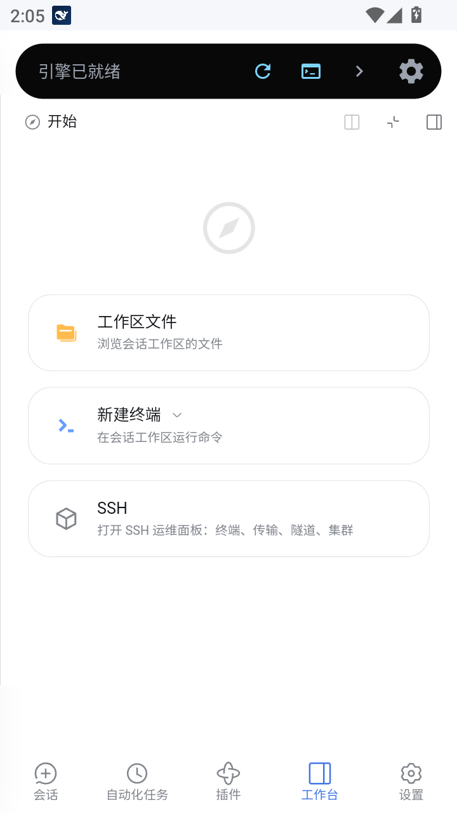
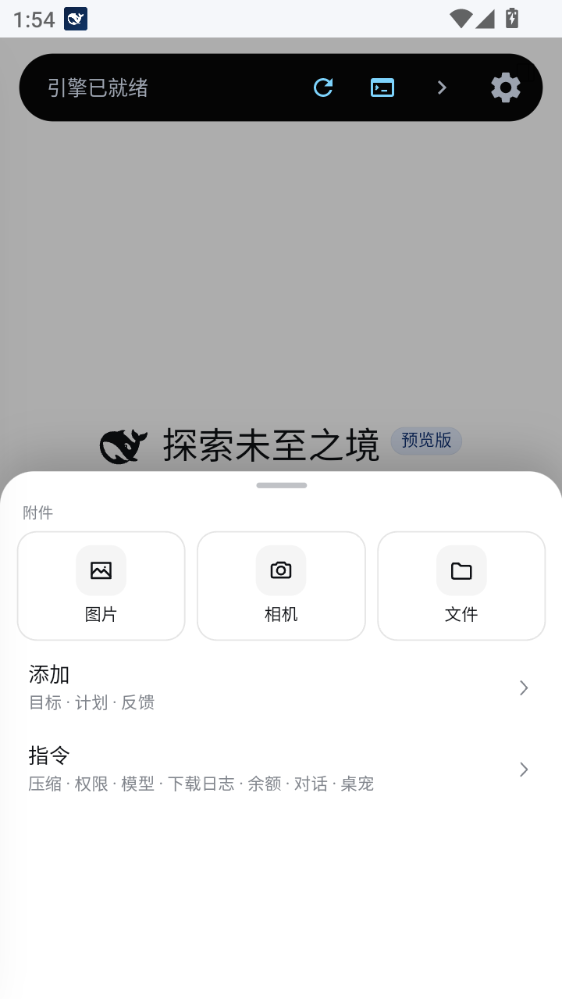
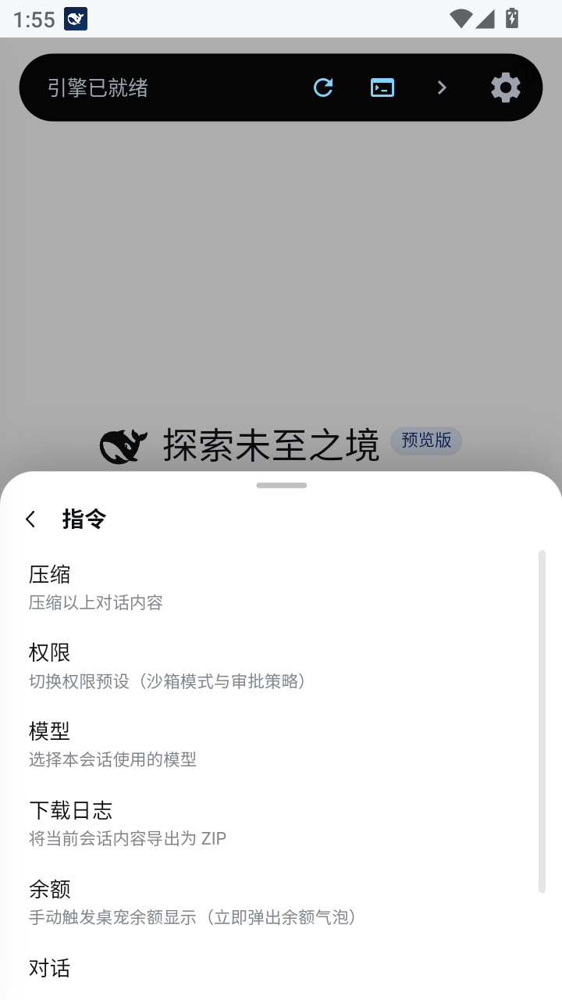
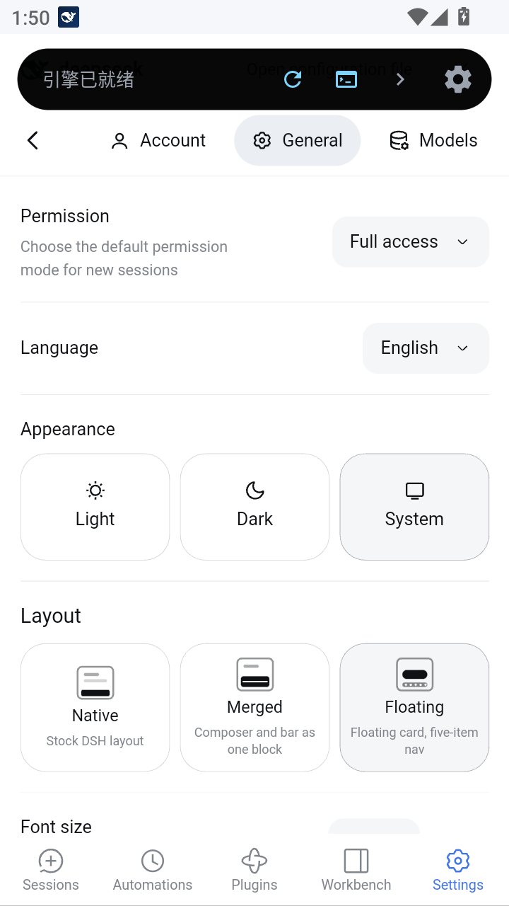

# 悬浮布局（v2 预设）

> 输入卡浮起 + 五项导航的**手机应用形态**。三套布局之一，切换入口：**设置 → 通用设置 → 布局模式**。
> 截图为 v0.4.0 在 MuMu 模拟器（物理 720×1280，CSS 视口 400×684）的整机实拍，浅色主题。

其他预设：[原生](preset-default.md) ｜ [融合](preset-classic.md) ｜ 回到 [README](../README.md)

---

## 界面总览

<table>
  <tr>
    <th align="center">主界面（空会话）</th>
    <th align="center">通用设置 · 布局模式</th>
  </tr>
  <tr>
    <td align="center"></td>
    <td align="center"></td>
  </tr>
  <tr>
    <td valign="top">悬浮输入卡 + <b>透明五项导航</b>（会话 / 自动化任务 / 插件 / 工作台 / 设置）。输入卡软阴影直接落到导航行，无硬边。</td>
    <td valign="top">「布局模式」三选一（<b>悬浮</b>选中），卡片带迷你线框缩略图；外观三卡与官方配色实时跟随。</td>
  </tr>
</table>

## 五项导航换页

<table>
  <tr>
    <th align="center">插件页</th>
    <th align="center">自动化任务页</th>
    <th align="center">工作台（右侧面板）</th>
  </tr>
  <tr>
    <td align="center"></td>
    <td align="center"></td>
    <td align="center"></td>
  </tr>
  <tr>
    <td valign="top">页面而非弹层，导航常驻可继续换页；当前页用官方蓝高亮。</td>
    <td valign="top">官方 schedules 面板页；再点一次「自动化任务」返回会话。</td>
    <td valign="top">直接开关官方右侧面板，手机宽度下自动全屏；<b>横滑一下即退出</b>。</td>
  </tr>
</table>

- **会话键是「回首页」**：在其它页点它回会话页；在会话页点它才弹会话抽屉。
- 图标直接用 DSH 自带符号（`--dsw-alias-state-business-primary` 上色当前页）。

## 加号面板（自绘一 / 二级菜单）

<table>
  <tr>
    <th align="center">一级菜单</th>
    <th align="center">二级菜单（指令）</th>
  </tr>
  <tr>
    <td align="center"></td>
    <td align="center"></td>
  </tr>
  <tr>
    <td valign="top">附件三块（<b>图片 / 相机 / 文件</b>）+ 各官方分组一行；覆盖式抽屉，不推正文。</td>
    <td valign="top">点分组进二级页，条目按「标题 + 官方描述」列出；支持任意深子层。</td>
  </tr>
</table>

- 数据与动作仍来自官方节点：读它的选项、派发它的 `mousedown`，不复制命令语义。
- 图片 / 相机走自建 `input[type=file]`（相机带 `capture`）；文件保留官方上传与校验链路。
- 加号 / 模型 / 权限 / 工作区选择全部从底部盖上来；返回键 / Esc / 遮罩逐层收起。

## 设置页与多语言

<table>
  <tr>
    <th align="center">中文（默认）</th>
    <th align="center">English（实时刷新）</th>
  </tr>
  <tr>
    <td align="center"></td>
    <td align="center"></td>
  </tr>
  <tr>
    <td valign="top">全屏接管：品牌行 + 可横滑页签 + 返回键；内容区左右横滑切页签。</td>
    <td valign="top">切 English 后 <b>Layout / Native / Merged / Floating</b> 与底栏文案立即刷新，无需重启。</td>
  </tr>
</table>

- 插件自带的配置页（如桌宠配置、插件市场）同样被接管，不出现兼容异常。
- 设置页内切预设：切到**原生**时设置页保持打开（悬浮窗形态），切到**融合**变全屏形态。

## 关键行为速查

| 行为 | 说明 |
|---|---|
| 切换预设 | 设置 → 通用设置 → 布局模式；即时生效、三档双向不残留 |
| 输入卡圆角 | `--dshm-v2-radius`（默认 20px），虚线描边跟随圆角 |
| 输入卡留白 | `--dshm-v2-gutter`（默认 8px） |
| 导航高度 | `--dshm-v2-nav`（默认 56px） |
| 引擎状态条让位 | `--dshm-engine-bar`（默认 56px；习惯先收起就设 `0px`） |
| 会话抽屉 | 固定 55% 屏高，条目少时底部留白 |
